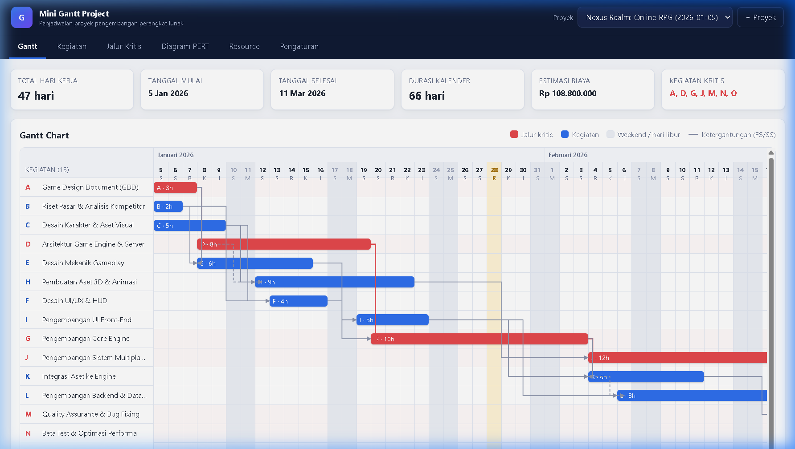
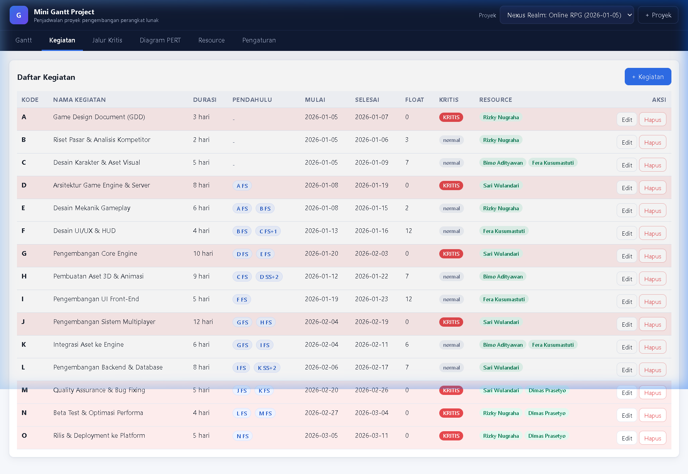
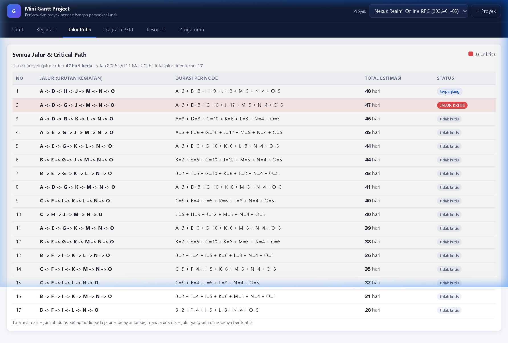
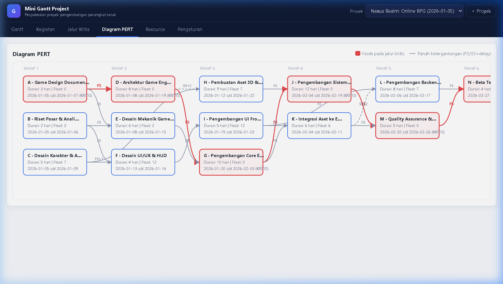
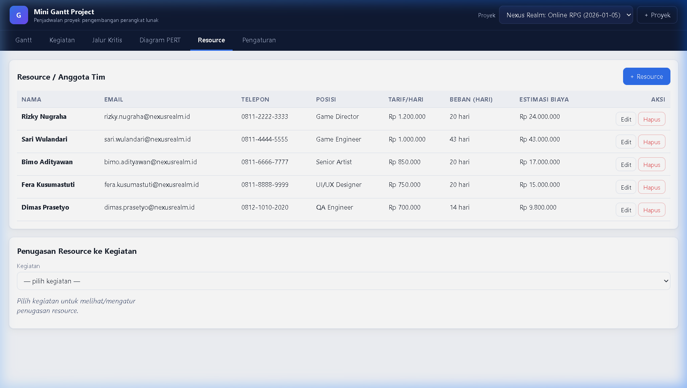
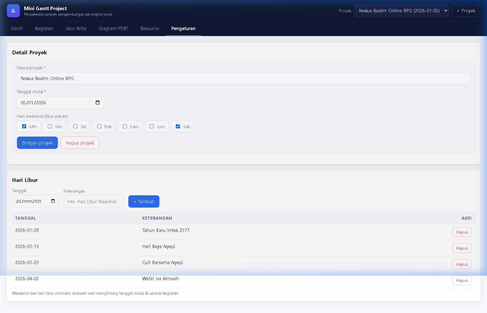

# Mini Gantt Project

Aplikasi web sederhana untuk **penjadwalan proyek pengembangan perangkat lunak**:
CRUD proyek/kegiatan/resource, perhitungan tanggal otomatis (lewati weekend & hari libur),
**Gantt chart** dengan garis ketergantungan, **Critical Path (CPM)**, dan **diagram PERT**.

**Stack:** Node.js + Express + SQLite (memakai `node:sqlite` bawaan Node, tanpa kompilasi native)
+ frontend HTML/CSS/JS murni + `node:test` untuk unit test.

## Tampilan Aplikasi

### Gantt Chart


### Jadwal Kegiatan


### Analisis Critical Path


### Diagram PERT


### Resource


### Pengaturan


---

## Kebutuhan

- **Node.js >= 24** (dibutuhkan modul bawaan `node:sqlite`)

Cek versi:

```bash
node -v
```

## Instalasi

```bash
# 1. clone repository lalu masuk ke folder proyek
git clone https://github.com/arky2ss/mini-gantt-project.git
cd mini-gantt-project

# 2. instal dependency (hanya express)
npm install

# 3. jalankan unit test (critical path, kalender, API)
npm test

# 4. jalankan server
npm start
```

Buka **http://localhost:3000** di browser.

> Pada saat pertama dijalankan, database SQLite dibuat otomatis di `data/mini-gantt.db`
> dan **data contoh** dimasukkan: proyek **"Nexus Realm: Online RPG"**
> dengan **15 kegiatan (A–O)** sehingga jalur kritis **A→D→G→J→M→N→O = 47 hari kerja**.
>
> Untuk mengembalikan data contoh kapan pun: `npm run seed`
> (me-reset seluruh isi database). Untuk memakai database lain: set env `DB_PATH`, port: `PORT`.

### Perintah yang tersedia

| Perintah        | Fungsi                                              |
|-----------------|-----------------------------------------------------|
| `npm start`     | Jalankan server (default port 3000)                 |
| `npm run dev`   | Jalankan server dengan auto-reload (`--watch`)      |
| `npm test`      | Jalankan seluruh unit test (`node --test`)          |
| `npm run seed`  | Reset & isi ulang data contoh A–O                   |

---

## Fitur

1. **CRUD proyek** — nama, tanggal mulai, pengaturan **hari weekend** (bisa dipilih per hari)
   dan **hari libur** tambahan.
2. **CRUD kegiatan** — nama, kode, durasi (hari kerja), **kegiatan pendahulu** dengan
   **tipe FS/SS** dan **delay**. Tanggal **mulai & selesai dihitung otomatis** dengan
   melewati weekend dan hari libur.
3. **CRUD resource/anggota tim** — nama, email, telepon, posisi, **tarif per hari**,
   serta **penugasan resource ke kegiatan** (plus estimasi biaya).
4. **Gantt chart** — bar timeline per kegiatan + **garis ketergantungan** (FS garis penuh / SS garis putus-putus),
   kolom weekend/hari libur diarsir, bar **jalur kritis berwarna merah**.
5. **Critical path** — tabel **semua jalur** (urutan, durasi per node, total estimasi)
   dengan penanda jalur kritis; float/total juga tampil di tabel kegiatan & Gantt.
6. **Diagram PERT** — node (kegiatan) dan panah (FS/SS + delay) terstruktur per tahap.
7. **Data contoh bawaan** — 15 kegiatan A–O, jalur kritis **A→D→G→J→M→N→O = 47 hari**.
8. **Validasi input, penanganan error, dan deteksi dependensi melingkar** (ditolak HTTP 400
   lengkap dengan urutan siklusnya).
9. **Unit test** untuk perhitungan critical path, kalender kerja, dan API.

---

## Data contoh (bawaan)

Proyek: **Nexus Realm: Online RPG** — mulai **5 Jan 2026** (Senin), weekend Sabtu & Minggu.
Hari libur: Tahun Baru Imlek (28 Jan), Nyepi (19–20 Mar), Wafat Isa Almasih (2 Apr).

| Kode | Kegiatan                           | Durasi | Pendahulu              |
|------|------------------------------------|--------|------------------------|
| A    | Game Design Document (GDD)         | 3      | —                      |
| B    | Riset Pasar & Analisis Kompetitor  | 2      | —                      |
| C    | Desain Karakter & Aset Visual      | 5      | —                      |
| D    | Arsitektur Game Engine & Server    | 8      | A (FS)                 |
| E    | Desain Mekanik Gameplay            | 6      | A, B (FS)              |
| F    | Desain UI/UX & HUD                 | 4      | B (FS), C (FS+1)       |
| G    | Pengembangan Core Engine           | 10     | D, E (FS)              |
| H    | Pembuatan Aset 3D & Animasi        | 9      | C (FS), D (SS+2)       |
| I    | Pengembangan UI Front-End          | 5      | F (FS)                 |
| J    | Pengembangan Sistem Multiplayer    | 12     | G, H (FS)              |
| K    | Integrasi Aset ke Engine           | 6      | G, I (FS)              |
| L    | Pengembangan Backend & Database    | 8      | I (FS), K (SS+2)       |
| M    | Quality Assurance & Bug Fixing     | 5      | J, K (FS)              |
| N    | Beta Test & Optimasi Performa      | 4      | L, M (FS)              |
| O    | Rilis & Deployment ke Platform     | 5      | N (FS)                 |

**Jalur kritis: A → D → G → J → M → N → O = 3+8+10+12+5+4+5 = 47 hari kerja.**
Proyek selesai estimasi: **11 Maret 2026**. Estimasi biaya total: **Rp 108.800.000**.

---

## Cara kerja perhitungan

- Semua perhitungan CPM memakai satuan **hari kerja** (offset integer), sehingga hasilnya
  konsisten terlepas dari kalender; offset baru dipetakan ke tanggal memakai kalender proyek.
- **Forward pass**: `ES = max(pendahulu)` dengan `FS: ES = EF_pendahulu + delay`,
  `SS: ES = ES_pendahulu + delay`; `EF = ES + durasi`.
- **Backward pass**: semua kegiatan tanpa penerus diberi `LF = durasi proyek`,
  lalu `FS: LF_pred = LS_penerus - delay`, `SS: LF_pred = LS_penerus - delay + durasi_pred`.
- **Float = LS - ES**; float 0 = **kegiatan kritis**; jalur yang seluruh nodenya kritis =
  **jalur kritis**.
- **Total estimasi jalur** = jumlah durasi node + delay pada edge antar node pada jalur.
- **Dependensi melingkar** dideteksi saat urutan topologis (Kahn) gagal; siklus dicari
  dengan DFS dan dikembalikan sebagai pesan 400: `Dependensi melingkar terdeteksi: A -> B -> A`.
- Batas aman: maksimal 2000 jalur dienumerasi (ditandai `truncated`), 50 pendahulu/kegiatan.

---

## REST API

Semua endpoint diawali `/api`. Response sukses memakai `{ "data": ... }`,
gagal memakai `{ "error": "...", "details": ... }` + kode status (400/404/500).

### Proyek & hari libur

| Method | Endpoint                       | Keterangan |
|--------|--------------------------------|------------|
| GET    | `/api/projects`                | Daftar proyek |
| POST   | `/api/projects`                | Buat proyek `{name, start_date, weekend_days}` |
| GET    | `/api/projects/:id`            | Detail proyek + hari libur |
| PUT    | `/api/projects/:id`            | Ubah proyek |
| DELETE | `/api/projects/:id`            | Hapus proyek (cascade) |
| GET    | `/api/projects/:id/holidays`   | Daftar hari libur |
| POST   | `/api/projects/:id/holidays`   | Tambah hari libur `{date, name}` |
| DELETE | `/api/holidays/:id`            | Hapus hari libur |

`weekend_days` berupa string hari (`'0,6'`, 0=Minggu..6=Sabtu) atau array angka.

### Kegiatan

| Method | Endpoint                       | Keterangan |
|--------|--------------------------------|------------|
| GET    | `/api/projects/:id/activities` | Daftar kegiatan + pendahulu + resource |
| POST   | `/api/projects/:id/activities` | Tambah kegiatan `{code?, name, duration, predecessors[]}` |
| PUT    | `/api/activities/:id`          | Ubah kegiatan (pendahulu diganti seluruhnya) |
| DELETE | `/api/activities/:id`          | Hapus kegiatan |

`predecessors`: `[{ "id": 1, "type": "FS", "delay": 0 }]` (type `FS`/`SS`, delay >= 0 hari kerja).

### Resource & penugasan

| Method | Endpoint                                   | Keterangan |
|--------|--------------------------------------------|------------|
| GET    | `/api/projects/:id/resources`              | Daftar resource + beban kerja |
| POST   | `/api/projects/:id/resources`              | Tambah resource |
| PUT    | `/api/resources/:id`                       | Ubah resource |
| DELETE | `/api/resources/:id`                       | Hapus resource |
| POST   | `/api/activities/:id/resources`            | Tugaskan `{resource_id}` |
| DELETE | `/api/activities/:id/resources/:resourceId`| Lepas penugasan |

### Analitik (jadwal, jalur, PERT)

| Method | Endpoint                       | Keterangan |
|--------|--------------------------------|------------|
| GET    | `/api/projects/:id/schedule`   | Jadwal: tanggal mulai/selesai, float, kritis, biaya |
| GET    | `/api/projects/:id/paths`      | Semua jalur + total estimasi + penanda jalur kritis |
| GET    | `/api/projects/:id/pert`       | Node & panah PERT (+ layer untuk layout) |
| GET    | `/api/projects/:id/summary`    | Ringkasan: hari kerja, biaya, beban per resource |

Contoh:

```bash
curl http://localhost:3000/api/projects
curl http://localhost:3000/api/projects/1/schedule
curl http://localhost:3000/api/projects/1/paths
```

---

## Struktur proyek

```
mini-gantt-app/
├── server.js            # bootstrap Express (static + API + error handler)
├── src/
│   ├── calendar.js      # kalender kerja (weekend + hari libur)
│   ├── cpm.js           # mesin CPM: topologi, forward/backward pass, jalur, siklus
│   ├── db.js            # koneksi & skema SQLite (node:sqlite)
│   ├── seed.js          # data contoh A–J (bisa: node src/seed.js --reset)
│   ├── errors.js        # HttpError / CycleError
│   ├── routes.js        # router REST API
│   ├── store.js         # akses data + jadwal/jalur/PERT
│   └── validate.js      # validasi input
├── public/              # frontend (index.html, css, js: api/gantt/pert/app)
├── test/                # unit test (calendar, cpm, api)
└── data/mini-gantt.db   # database (dibuat otomatis)
```

## Troubleshooting

- **`Cannot find module 'node:sqlite'`** → gunakan Node.js >= 24 (`node -v`).
- **Port bentrok** → `PORT=8080 npm start`.
- **Ingin data bersih** → `npm run seed` (atau hapus `data/mini-gantt.db` lalu `npm start`).
- **Test merah setelah mengubah data contoh** → jalankan `npm test` lagi; test memakai
  database in-memory sehingga tidak memengaruhi `data/mini-gantt.db`.
